# deckhand

A terminal UI for running several AI agent CLIs side by side on Windows. The left pane lists your sessions, each with a live status, what it's doing, its branch and what it has cost; the right pane is the selected session's real terminal. Each session can work in its own git worktree, and from the list you can review its diff, open a pull request, merge it and clean up the worktree.


It runs your normal Windows `claude.exe` (and `codex`, `gemini`, `pwsh`, `cmd`) in a ConPTY pseudo console, so your own Claude settings, login and proxy configuration apply unchanged. No tmux or WSL is needed.

## Features

**Running agents**

- Claude Code, Codex, Gemini CLI, PowerShell, cmd and your own scripts or profile functions, each in a real terminal ([Custom agents](#custom-agents-your-own-scripts-and-profile-functions)).
- A new session with a folder box that completes as you type (`n`), or another one in the same folder with shift+enter ([New session dialog](#new-session-dialog)).
- Claude sessions resume after a restart, and every session's last output is kept ([Resuming](#resuming), [Output after a restart](#output-after-a-restart)).
- Open more windows while one is running, like Notepad: the first keeps the saved list, the others are temporary (`deckhand --temp`) ([More than one window](#more-than-one-window)).
- Fork a Claude conversation to try another approach (`f`) ([Forking](#forking)).
- Hide the list to give the session the full width (`F3`), and go back to it from a session with `F5` ([Hiding the session list](#hiding-the-session-list)).
- Open a session's folder in your editor, Explorer or a new terminal tab (`o`, `O`, `t`) ([Opening a session's folder](#opening-a-sessions-folder)).

**Staying on top of them**

- Status icons for working, needs you and finished, from Claude's hooks ([Status icons](#status-icons)).
- Under each session, Claude's latest reply or the tool it wants to run, then its branch, pull request, model, context window and cost ([Session details](#session-details), [Cost](#cost)).
- Claude sessions named after Claude's title for the conversation, its automatic title or `/rename` ([Session names](#session-names)).
- Desktop notifications when a session needs you or finishes ([Notifications](#notifications)).
- Filter the list (`/`), show only the sessions that need you (`@`), and jump to the next one (`tab`) ([Finding sessions](#finding-sessions)).
- Groups with headers you can fold, and reordering with shift+↑/↓ or by dragging with the mouse ([Groups](#groups), [Session list keys](#session-list)).

**Git workflow**

- A worktree and branch per session (`W`, or ctrl+t in the dialog), also for a notes folder that works on a separate code repo ([Worktree sessions](#worktree-sessions)).
- A diff of the session's work against the default branch (`d`) ([Diff preview](#diff-preview)).
- Push the branch and open a pull request (`p`), then see its checks in the list ([Pull requests](#pull-requests)).
- Merge it on GitHub, or locally without GitHub (`m`) ([Merging](#merging)).
- Close the session, removing the worktree and branch once the work is merged (`x`) ([Worktree sessions](#worktree-sessions)).

**Setup**

- A config screen (`c`) for agents, notifications, the list, history and open commands. Test an agent with `t`, or pick one from your PowerShell profile ([The config screen](#the-config-screen)).
- Help for wherever you are, with `?` or `F1` ([Keys](#keys)).

## Contents

- [Getting started](#getting-started) · [A typical workflow](#a-typical-workflow)
- [Status icons](#status-icons) · [Session details](#session-details) · [Session names](#session-names) · [Cost](#cost) · [Notifications](#notifications) · [Finding sessions](#finding-sessions)
- [Keys](#keys) · [The config screen](#the-config-screen) · [Custom agents](#custom-agents-your-own-scripts-and-profile-functions)
- [Diff preview](#diff-preview) · [Worktree sessions](#worktree-sessions) · [Pull requests](#pull-requests) · [Merging](#merging)
- [Groups](#groups) · [Hiding the session list](#hiding-the-session-list) · [Opening a session's folder](#opening-a-sessions-folder) · [Path aliases](#path-aliases)
- [Resuming](#resuming) · [More than one window](#more-than-one-window) · [Forking](#forking) · [Output after a restart](#output-after-a-restart)
- [Build](#build) · [Debugging](#debugging)

## Getting started

You need Windows 10 (1809 or later) or Windows 11, [Go](https://go.dev/dl/) 1.27 or later to build it, and the agents you want to run on your `PATH`, such as Claude Code's `claude.exe`. Windows Terminal or WezTerm is recommended: in them, deckhand also gets shift+enter and other modified keys (see [Inside a session](#inside-a-session)).

1. **Install it.** Either let Go install it in `%USERPROFILE%\go\bin`:

   ```powershell
   go install github.com/sayedihashimi/deckhand@latest
   ```

   or build it from a clone into a folder of your own:

   ```powershell
   git clone https://github.com/sayedihashimi/deckhand
   cd deckhand
   go build -o $HOME\.local\bin\deckhand.exe .
   ```

   Use a folder without spaces in its path, so Claude's hook commands work without quoting.

2. **Put it on your PATH.** If that folder isn't on it yet, add it for your user and open a new terminal:

   ```powershell
   [Environment]::SetEnvironmentVariable('Path', [Environment]::GetEnvironmentVariable('Path', 'User') + ";$HOME\.local\bin", 'User')
   ```

   `deckhand version` should now print the version.

3. **Run it.** In Windows Terminal, run:

   ```powershell
   deckhand
   ```

   It opens with an empty list the first time.

4. **Start a session.** Press `n`, type or pick a folder (`tab` completes it), choose the agent with `shift+tab` and `←/→` if it isn't the one you want, and press `enter`. The agent starts on the right. Type into it, and press `F5` to go back to the list.

5. **Find your way around.** `?` (or `F1`) shows the keys for wherever you are, `c` opens the config screen and `q` quits. Claude sessions can be resumed the next time you start deckhand.

deckhand needs no setup. It works with your existing Claude Code settings and login, and passes its hooks to each Claude session itself, so it never edits your `~/.claude/settings.json`. Its own settings are in `~/.config/deckhand/config.toml` (`deckhand config` prints the path), and its state is in `%LOCALAPPDATA%\deckhand`. `deckhand help` lists the commands.

## A typical workflow

1. **Start a worktree session.** Press `n`, pick the folder and turn the worktree on with `ctrl+t`, or press `W` on a session in that repo. deckhand makes a branch and a folder for it with a name such as `quiet-otter`, and starts the agent there. From a folder that isn't a git repo, such as your notes, pick the code repo in the Repo row (see [Worktree sessions](#worktree-sessions)).

   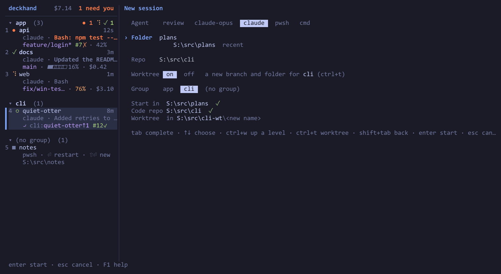

2. **Watch it in the list.** The icon says whether it's working (⠹), needs you (●) or has finished (✓), and the line below it says what it's doing. `tab` selects the next session that needs you. While deckhand isn't focused, you also get a notification.
3. **Answer it.** Press `enter` (or the session's number) to type into it, answer the prompt, then press `F5` to go back to the list.
4. **Review the work.** `d` shows the branch's changes against the default branch, committed or not.

   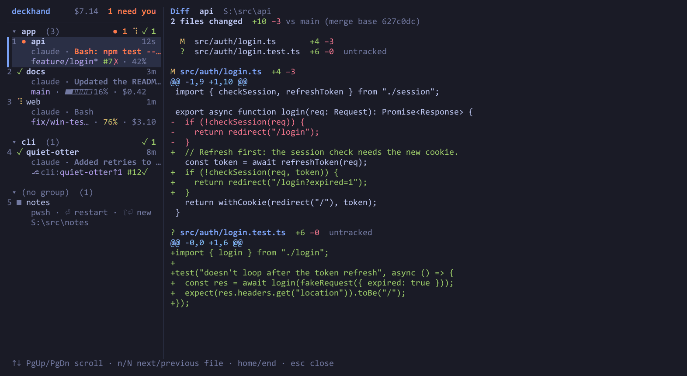

5. **Open a pull request.** `p` asks, then pushes the branch and opens a PR. Its number and checks show in the list from then on, such as `#12✓`.

   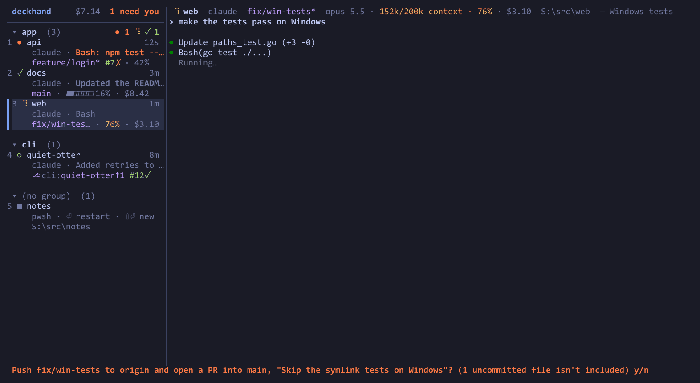

6. **Merge it.** `m` squash-merges the PR on GitHub once its checks pass, after asking. Without GitHub, it merges the branch locally.

   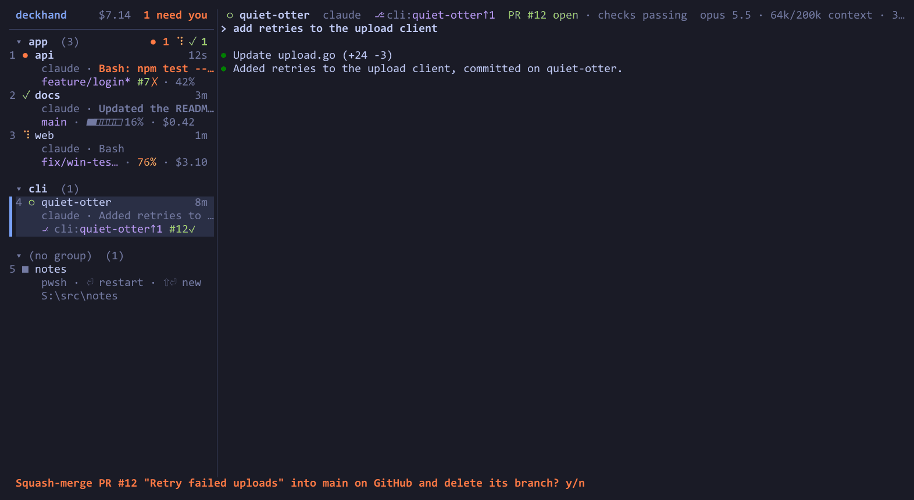

7. **Clean up.** After the merge, deckhand offers to close the session. `y` (or `x` later) ends the agent and removes the worktree and the branch, since the work is merged.

## Status icons

| Icon | Meaning | Source (Claude) |
|---|---|---|
| ⠹ (spinner) | Working: thinking or running a tool | `UserPromptSubmit`, `PreToolUse`, `PostToolUse` hooks |
| ● (blinking, orange) | Needs you: a permission prompt or a question | `PermissionRequest`, `PreToolUse` on `AskUserQuestion` |
| ✓ (bold green) | Finished its turn, and you haven't looked yet | `Stop` |
| ○ | Idle and seen | |
| ■ | Not running (press enter to resume, shift+enter to start a new one) | process exit |
| ◌ | Starting | |

- **Claude:** status comes from hooks. deckhand passes a per-session settings file with `claude --settings`, so your `~/.claude/settings.json` is never modified.
- **Other CLIs:** status is guessed from output activity, and a terminal bell counts as "needs you".
- **Esc interrupts:** if a Claude turn is interrupted with Esc, no `Stop` hook fires. After 20 s of silence the status drops back to idle and shows "interrupted?".

## Session details

The second line under each session is the agent and what it's doing. For Claude it also shows:

- **Finished:** the start of Claude's reply, in place of "your turn" (the ✓ already says it's your turn). It's the first line of the reply with Markdown removed, cut to fit, and bold until you look at the session. It shows once the turn has ended, never while Claude is still working, so an old reply isn't mistaken for a new one. The session header shows the reply too, all its lines joined, before the folder. It takes at most 40 % of the header's width, cut with `…`, so a long reply can't push the folder, worktree and title out of view:

  ```toml
  [header]
  reply_width = 40   # percent of the header's width; 0 hides the reply in the header
  ```
- **Needs you:** what the tool wants to do, such as `Bash: npm test`.

The third line under each session shows the git branch, then for Claude the model, how full the context window is and what the session has cost:

```
 deckhand          $12.40 today
───────────────────────────────
▌2 ✓ api-refactor           1m
▌    claude · Fixed the redire…
▌    main* · ▰▰▱▱▱ 42% · $1.84
```

- **Branch:** `*` means uncommitted changes (untracked files count), `↑2↓1` is commits ahead of and behind the upstream (for a worktree session, the branch it started from). `⎇` marks a worktree session. Outside a git repo the line shows the folder.
- **Pull request:** after the branch, its GitHub PR's number and state: `#12✓` (checks passing), `#12✗` (failing), `#12…` (running), `#12` (no checks), `#12 draft`, `#12 merged` or `#12 closed`. When the line is short of room, the model goes first, then the cost, then the context. See [Pull requests](#pull-requests).
- **Model and context:** read from the end of the Claude transcript. The context is the input tokens of the latest reply, including cached ones, which is how much context the next turn starts with. It's shown as how full the context window is: a meter and a percentage (`▰▰▱▱▱ 42%`), coloured yellow from 60 % and orange over 80 %, so you can see when a session is close to auto-compacting. Short of room, the meter goes first (after the model), then the cost, then the percentage. The config screen (`c`, Session list) can show just the percentage, or tokens (`84k/200k`, then `84k`). The session header shows both: `84k/200k context · 42%`.
- **Context window size:** from Claude's status line JSON (`context_window.context_window_size`, see [Cost](#cost)) when there is one, which is exact. Otherwise from `[info.context_windows]` in the config for that model, then the model ID: a `[1m]` suffix, or a Fable, Mythos, Opus 5, Sonnet 5 or Haiku 5 model, means 1,000,000. Then `[info] context_window`, then 200,000 for other Claude models. Without a size (another agent's model) it shows the token count. The transcript doesn't say which window the model ran with, so for a model that can run with either (such as Opus 4.6 with `[1m]`), the status line's number is the one to trust.

  ```toml
  [info]
  context        = "meter"    # or "percent", "tokens"
  context_window = 200000     # for models deckhand doesn't know

  [info.context_windows]
  "claude-opus-4-6" = 1000000 # a model ID matches the longest entry it starts with
  ```
- **↻ compacted:** after Claude compacts the conversation (`/compact`, or automatically when the context is full), the second line starts with `↻ compacted` until the next reply. deckhand sees it in the transcript, or as a sharp drop in context between two replies (over half, and at least 20k tokens).
- **Cost:** what the session has cost so far, over all its conversations: `$0.04`, `$1.84`, `$12`. The list header shows what all sessions spent today (since local midnight): `$12.40 today`. When the header is short of room, it drops "today" (`$12.40`), then "n need you" takes its place. The session header shows the cost too. It's kept in `sessions.json`, so an exited session still shows it after a restart. See [Cost](#cost).
- Details refresh every 3 s for running and selected sessions and every 30 s for the rest, in the background. The session header shows them in full.

## Session names

A session is named after its folder (a worktree session after its branch), and `r` renames it. A Claude session (a custom `type = "claude"` agent too) takes its name from Claude's own title for the conversation, which Claude writes to the transcript:

- Until it's renamed, the name is Claude's automatic title, once Claude has made one. Before that, it's the folder's name.
- `/rename` in Claude renames the session, and so does `r` in deckhand. The latest of the two wins: a `/rename` replaces an earlier `r`, and a later `r` replaces it again. deckhand doesn't send its name to Claude.
- A name Claude was started with (for example by a wrapper that passes `--name`) isn't a rename, nor is Claude writing it again on resume, so such a session still gets the automatic title. Claude's title counts as a rename only when it differs from the one before it.
- `sessions.json` keeps the name and where it came from (`name_source`: `folder`, `ai`, `claude` or `user`), so after a restart the name stays and an older title doesn't come back.
- A fork keeps its `<name> (fork)` name until you rename it, with `/rename` in the fork or with `r`.

To keep the names deckhand gives, turn **Title** off on the [config screen](#the-config-screen), or set `follow_claude_title = false` under `[list]`. Other agents keep their folder's name.

## Cost

deckhand shows what each Claude session has cost (see [Session details](#session-details)). The number comes from one of two places:

- **Claude's own number.** Claude Code passes its status line command session JSON that includes `cost.total_cost_usd`. deckhand sets a status line command, `deckhand statusline`, in the per-session `--settings` file it already passes for the hooks, so `~/.claude/settings.json` is never edited. It saves the numbers to the session's folder (`statusline.json`), then runs your own status line (below). Claude runs it after each reply, a few hundred milliseconds after things settle.
- **An estimate from the transcript,** shown with `~` (`~$1.84`): the usage of each of Claude's replies (input, cache writes, cache reads and output), priced by model from a table built into deckhand. Sub-agents' replies aren't counted. It's used before the first status line arrives, for sessions from before this version, and whenever Claude's number is missing or well below the estimate (Claude can start its count again when a conversation is resumed).

**Your own status line still works.** A `statusLine` in `--settings` replaces the one in your settings files (command-line settings come before user and project settings), so deckhand passes yours through: `deckhand statusline` reads your `statusLine` from the session folder's `.claude/settings.local.json`, then `.claude/settings.json`, then `~/.claude/settings.json` (or `CLAUDE_CONFIG_DIR`), the order Claude Code uses, and only reads them. It runs that command the way Claude does (in Git Bash when it's installed, else PowerShell), with the same JSON on stdin and the same environment (`COLUMNS`, `LINES`), and prints what it prints. Its `padding` and `refreshInterval` are copied to deckhand's. Changes to your command apply on the next run; a new `padding` or `refreshInterval` applies to sessions started after it. If you don't have a status line, deckhand's prints nothing. Claude Code still treats that as a custom status line, so it may stop showing the `? for shortcuts` hint. A status line from your organization's managed settings takes precedence over deckhand's; then only the estimate is shown.

**Dollars, tokens or off.** The dollar amount is at API prices. On a Pro or Max plan it's notional: it says what the same use would cost on the API, not what you pay. The config screen (`c`, Session list) can show tokens instead (`1.2M tok`: input, cache writes and output, without cache reads) or hide cost entirely. In `config.toml`:

```toml
[cost]
show       = "dollars"   # or "tokens", or "off"
statusline = true        # false: don't add deckhand's status line; only the estimate is shown

# Prices in dollars per million tokens, for a model the built-in table
# doesn't know or whose price changed. A model ID matches the longest
# entry it starts with. cache_write (5-minute), cache_write_1h and
# cache_read default to 1.25x, 2x and 0.1x the input price.
[cost.prices]
"claude-opus-5-5" = { input = 4, output = 20, cache_read = 0.2 }
```

**Today** counts what each session spent since local midnight: deckhand keeps each session's total at the start of the day. For a conversation it sees for the first time, spending before midnight is left out using the transcript's timestamps.

## Notifications

deckhand shows a Windows notification when a session needs you (a permission prompt, a question, or a bell from another CLI) or a Claude session finishes its turn. A permission notification says what the tool wants to do (for example the Bash command), and a "finished" one quotes the start of Claude's reply.

By default it only notifies while deckhand's window isn't focused (the terminal reports focus changes). If the terminal doesn't report focus, it notifies for every session except the one on screen. Change this in the config file:

```toml
[notifications]
enabled = true          # false turns them off
when    = "unfocused"   # or "always"
```

Run `deckhand notify-test` to check that notifications appear. If they don't, check Windows' notification settings and Do Not Disturb. Notifications come from Windows PowerShell, so that's the name they show.

## Finding sessions

- `/` filters the list as you type. It matches the name, agent, folder and branch, ignoring case, and letters in order match too. `enter` or `tab` keeps the filter, `esc` clears it.
- `@` shows only the sessions that need you or finished since you looked. Press it again to show all.
- `tab` selects the next session that needs you, then the next one that finished.

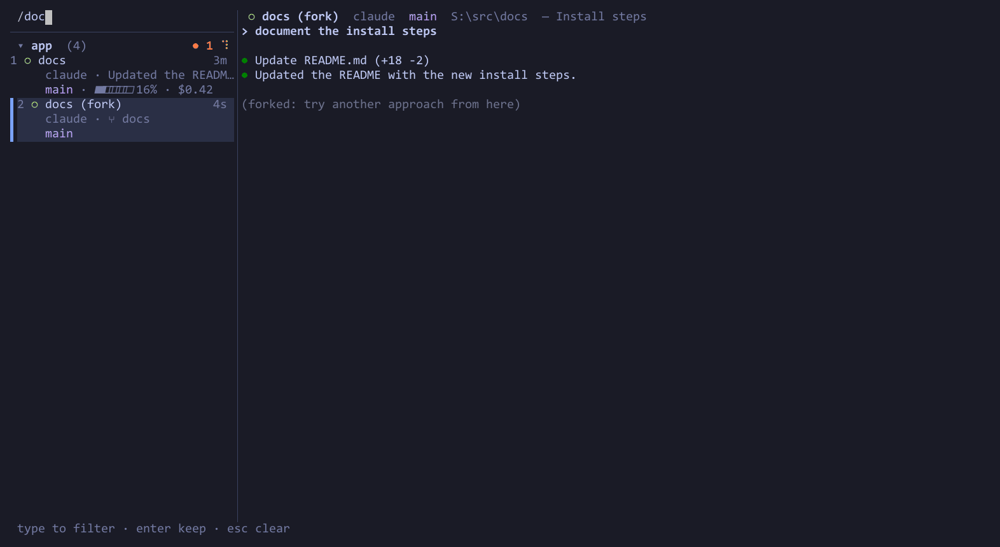

## Keys

Press `?` in the session list, or `F1` anywhere (also inside a session, the new-session dialog and the config screen), for a summary of the keys, the status icons and where the config file is. The keys for where you pressed it come first, in full; the other groups follow in two columns as far as they fit, and `↑/↓` scrolls to the rest (the last line says how many more groups there are). `esc`, `?`, `F1` or `q` closes it and goes back to where you were, with nothing lost.

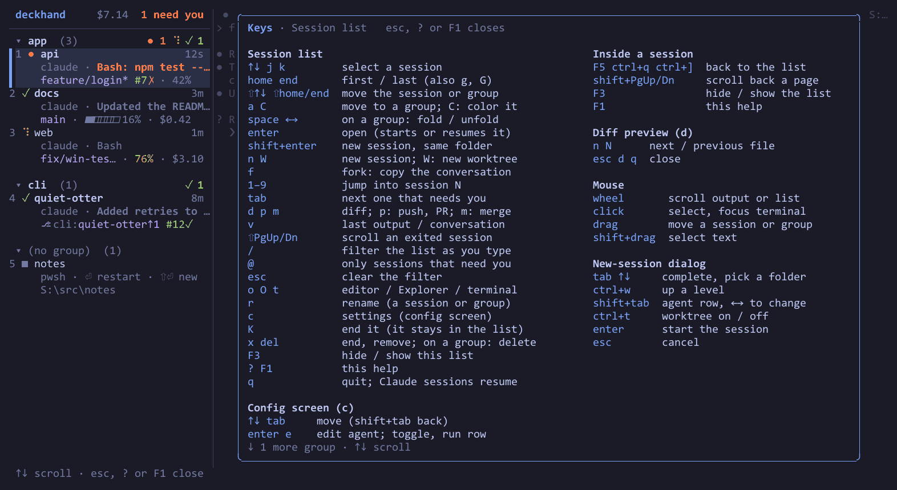

### Session list

| Key | Action |
|---|---|
| ↑/↓ or j/k | Select a session (its terminal shows on the right) |
| home/end or g/G | Select the first or last session |
| shift+↑/↓ | Move the selected session up or down one place, or drag it with the mouse. The order is saved, so it's the same after a restart. With a filter on, it moves past the next session you can see, skipping hidden ones |
| shift+home/end | Move the selected session to the top or the bottom (with a filter on: just before the first, or after the last, session you can see). With groups, to the top or the bottom of its group |
| a | Move the selected session to a group: type to filter the groups or to name a new one, ↑/↓ choose, enter moves it. `(no group)` takes it out of its group (see [Groups](#groups)) |
| space, ←/→ | On a group header: fold or unfold the group (← folds, → unfolds; `enter` also switches). ← on a session in a group selects its header |
| enter (or → or l) | Type into the session; starts or resumes it if it isn't running |
| shift+enter | Start a new session with the same agent and folder, right below the selected one. The selected session is left as it is, so its conversation can still be resumed. Claude gets a fresh conversation; a custom agent runs its normal command, not its `resume` one. ESC enter (what a remapped shift+enter sends) does the same. Where a terminal sends plain enter for shift+enter, it acts like enter |
| 1–9 | Jump straight into session N |
| tab | Select the next session that needs you, then the next one that finished |
| / | Filter the list as you type. Matches the name, agent, folder and branch, ignoring case; letters in order also match, and every word must match. enter keeps the filter (or opens the session if only one matches), tab keeps it, esc clears it |
| @ | Show only sessions that need you or finished since you looked (press again to show all) |
| esc | Clear the filter |
| v | For an exited Claude session, switch between its last output and the conversation from its transcript (see [Output after a restart](#output-after-a-restart)) |
| shift+PgUp / shift+PgDn | Scroll an exited session's output a page at a time |
| d | Preview the session's changes as a diff against the default branch (see [Diff preview](#diff-preview)) |
| p | Push the session's branch and open a pull request for it, or open the one it has (see [Pull requests](#pull-requests)) |
| m | Merge the session's branch: its GitHub PR, or locally into the default branch without GitHub, then offer to close the session (see [Merging](#merging)) |
| n | New session (see below) |
| W | Start a new worktree session with the same agent and repo, right below the selected one (see [Worktree sessions](#worktree-sessions)) |
| f | Fork a Claude session: a new session right below it that starts from a copy of its conversation, named `<name> (fork)` (see [Forking](#forking)) |
| o | Open the session's folder (its worktree, if it has one) in your editor (see [Opening a session's folder](#opening-a-sessions-folder)) |
| O | Open the session's folder in Explorer |
| t | Open a new Windows Terminal tab in the session's folder (its worktree, if it has one) |
| r | Rename the session. On a group header: rename the group |
| c | Config screen: agents, notifications, the session list, history and open commands (see [The config screen](#the-config-screen)) |
| K | End the session's process (it stays in the list) |
| x (or delete) | End and remove the session, after asking (`Y/n`: `enter` answers yes, `n` or `esc` cancels). For a worktree session, its worktree and branch are removed too if the work is merged; otherwise you choose (see [Worktree sessions](#worktree-sessions)). On a group header: delete the group, after asking; its sessions move to "(no group)" and none are removed |
| F3 | Hide or show the session list (see [Hiding the session list](#hiding-the-session-list)) |
| F5 (or ctrl+q, ctrl+]) | Show the session list if it's hidden |
| ? or F1 | Show the keys |
| q (or ctrl+c) | Quit (Claude sessions can be resumed next time) |

### Inside a session

| Key | Action |
|---|---|
| F5 (or ctrl+q, ctrl+]) | Back to the session list, showing it again if it's hidden. Every other key except F3, F5 and F1 goes to the agent. |
| F3 | Hide or show the session list, so the session gets the full width |
| shift+PgUp / shift+PgDn | Scroll back through the output a page at a time |
| F1 | Show the keys. deckhand keeps F1, so it doesn't reach the agent. `?` is typed text and goes to the agent. |

Modified keys that plain terminal input can't express, such as shift+enter (a new line in Claude), ctrl+enter and ctrl+tab, go to the agent in the keyboard protocol it asked for (kitty `CSI u`, or xterm modifyOtherKeys), and as plain enter/tab to apps that asked for neither. For deckhand to see those modifiers, the terminal it runs in has to report them. In Windows Terminal and WezTerm, deckhand turns on win32-input-mode for this. Without it, Windows turns shift+enter into plain enter and `ctrl+\` into ctrl+space. In other terminals, shift+enter may arrive as plain enter; Claude's `\` then enter still adds a new line.

- **Terminals with shift+enter remapped:** a common Claude Code setup makes shift+enter send ESC enter (for example a Windows Terminal `sendInput` action with `"\u001b\r"`). In the session list, ESC enter starts a new session just like shift+enter. Inside a session it reaches the agent unchanged, and Claude reads it as a new line.
- **Forcing the mode:** set `DECKHAND_KEY_RECORDS=1` to turn win32-input-mode on in another terminal that sends win32-input-mode records, or `0` to turn it off. With it on in a terminal that doesn't send records, some keys arrive garbled.

### Mouse

- **Wheel over the terminal:** scrolls back through the output. Any key, or wheeling back down, returns to the live view. If the app turns on mouse reporting itself (a fullscreen TUI such as Claude's fullscreen renderer), the wheel and clicks go to the app instead, so it scrolls its own view.
- **Wheel or click in the session list:** moves the selection. Clicking the terminal focuses it.
- **Dragging a session in the list:** press on it and move the pointer to reorder it. A line shows where it will land: on the top of a session it goes above it, on the bottom line below. Releasing moves it there and saves the order, as shift+↑/↓ does (with a filter on, positions count only the sessions you can see). Holding the pointer on the list's header or its last row scrolls the list. `esc`, or releasing over the terminal, cancels. With groups, drag sessions into, out of and between groups, and drag a group's header to move the group (see [Groups](#groups)).
- **Clicking a group's ▾/▸:** folds or unfolds it.
- **Selecting text:** deckhand uses mouse reporting, so in Windows Terminal hold **shift** while dragging.

### New session dialog

The folder box lists matching folders as you type. Recent folders come first, then the folders in the directory you're typing in. Matching ignores case and also finds letters typed in order (`dnw` finds `dotnet-new-web`). A plain word searches the current folder and your recent folders. The "Start in" line shows exactly which folder will be used.

| Key | Action |
|---|---|
| tab | Complete the highlighted (or best) match and list its subfolders |
| ↑/↓ | Choose from the list (↑ from the top moves to the row above, ↓ past the bottom to the row below) |
| ctrl+w (or ctrl+backspace) | Up one level |
| shift+tab | Back a row (to the agent row, then ←/→ to change agent) |
| ctrl+t | Turn the worktree on or off (when there's a git repo; see [Worktree sessions](#worktree-sessions)) |
| enter | Start the session (with an empty box: the current folder) |
| esc | Cancel |

When the folder isn't in a git repo, a **Repo** row lets you pick a code repo for the session, and when there's a repo, a **Worktree** line turns on a worktree for it (see [Worktree sessions](#worktree-sessions)).

The last agent you used is preselected. Sessions are named after their folder (worktree sessions after their branch); press `r` to rename one.

## The config screen

Press `c` in the session list to set deckhand up without editing `config.toml`. It opens in the main area, like the new-session dialog. The welcome screen suggests it when there's no config file yet.

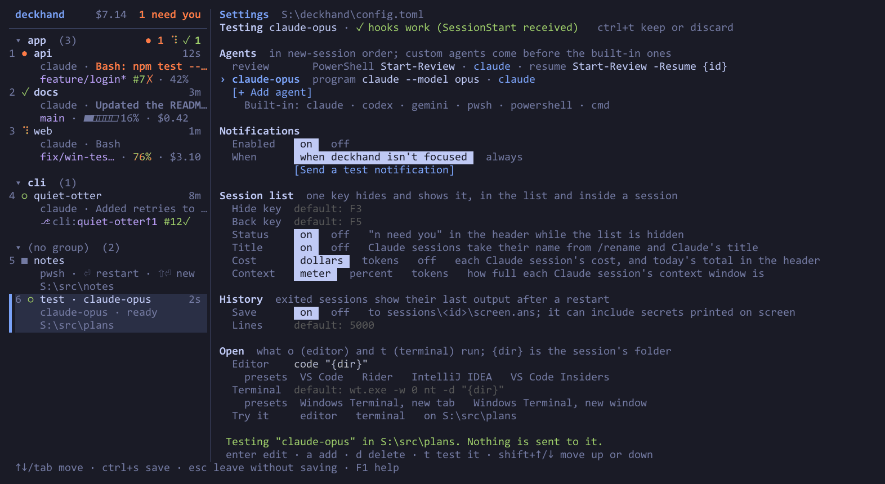

- **Agents:** your custom agents, in the order the new-session dialog shows them, then the built-in ones. `enter` edits one, `a` adds one, `d` deletes it and `shift+↑/↓` moves it. The form asks for a name, the kind (a PowerShell command, or a program or script), the command, arguments (for a program), the type (Claude Code or other) and, for a PowerShell command, how to resume it (with `{id}`). It checks the agent with the same rules as loading the file, and shows any problem under the field.
- **Testing an agent:** `t` on an agent, or the form's `[Test]` button, starts the agent as it's edited (saved or not) in a temporary session, `test · <name>`, in the selected session's folder (or the current folder when none is selected). The session appears in the list and is selected, and the config screen stays open with a status line at the top: `starting…` then `running` for a program or shell. For a Claude agent it shows `waiting for Claude's SessionStart hook…`, then `✓ hooks work (SessionStart received)`. If no hook arrives within about 30 s it shows `✗ no hook events yet`, with a hint: a PowerShell agent must call `claude`, not `claude.exe`, so the shim applies, and a program agent must pass deckhand's arguments on. If the agent exits, it shows the exit code and the last lines of output. A test is a real start (for Claude, a real, empty conversation), but nothing is sent to it. When you're done, `ctrl+t` (or `t` on an agent) asks whether to keep it as a normal session, named after its folder (`k`), or discard it (`x`). `esc` leaves the test running. Leaving the config screen during a test asks the same question. A Claude test isn't ended while Claude is still starting: a discard waits until Claude is ready, or until the 30 s timeout, and shows "stopping when Claude is ready…" until then.
- **Pick from your PowerShell profile:** for a PowerShell agent, "Pick from your PowerShell profile…" (or `ctrl+p`) lists the functions and aliases your profile defines, leaving out PowerShell's own. Type to filter, `enter` to pick. If the function has a `-Resume` parameter, deckhand assumes it starts Claude and suggests `<name> -Resume {id}` as the resume command. Listing them runs PowerShell once with your profile, in the background (at most 10 s).
- **Notifications:** on or off, when (only while deckhand isn't focused, or always), and a button that sends a test notification.
- **Session list:** the key that hides and shows the list (empty means `F3`), the key that goes back to the list from a session (empty means `F5`), whether the status line shows while it's hidden, whether Claude sessions take Claude's title as their name (**Title**, see [Session names](#session-names)), whether cost shows as dollars, tokens or not at all, and whether context shows as a meter, a percentage or tokens. See [Hiding the session list](#hiding-the-session-list) and [Cost](#cost).
- **History:** whether each session's output is saved for after a restart, and how many lines are kept (empty means 5000). See [Output after a restart](#output-after-a-restart).
- **Path aliases:** the names of the `[[paths.alias]]` entries, which are edited in the file. See [Path aliases](#path-aliases).
- **Open:** the editor and terminal commands, with presets (VS Code, Rider, IntelliJ IDEA, VS Code Insiders; Windows Terminal in a new tab or a new window). "Try it" runs the command as typed on the selected session's folder.

Keys: `↑/↓` or `tab`/`shift+tab` move, `←/→` (or `space`, `h`/`l`) change a choice, `enter` confirms (on an agent it edits it, like `e`), `a` adds an agent, `d` (or `delete`) deletes it, `shift+↑/↓` (or `K`/`J`) moves it, `t` tests it (then `ctrl+t` asks: `k` keeps the test session, `x` discards it, `esc` decides later), `ctrl+s` saves, and `esc` leaves (asking first if there are unsaved changes). In the agent form, `↑/↓` or `tab` move between fields, `enter` is done (on `[Test]` it starts a test), `esc` cancels and `ctrl+p` picks from your profile; in the profile picker, type to filter, `↑/↓` choose, `enter` picks and `esc` goes back to the form. `F1` shows all of these, with the config screen's keys first. The title says "unsaved changes" until you save.

**Saving** writes the file atomically (a temporary file, then a rename) and keeps the previous one as `config.toml.bak`. The new settings apply straight away, without a restart: new agents show up in the new-session dialog, and running sessions keep running. A session whose agent you renamed or deleted keeps working until it exits.

> [!NOTE]
> Saving rewrites the whole file, so comments you added by hand are lost (the TOML library can't keep them). If the file has comments other than the sample's, the screen says so and asks before the first save. The old file, comments included, is in `config.toml.bak`. Tables the screen doesn't edit are kept.

## Custom agents (your own scripts and profile functions)

Define your own agents in `~/.config/deckhand/config.toml` (`deckhand config` prints the path and creates a commented sample), or add them on the [config screen](#the-config-screen). They appear first in the agent row.

```toml
# A PowerShell function or alias from your profile:
[[agents]]
name   = "smc"
pwsh   = "smc"                # runs in PowerShell with your profile loaded
type   = "claude"             # it starts Claude: status from hooks, resumable
resume = "smc -Resume {id}"   # how to resume; {id} is the Claude session ID

# A program (on PATH or a full path), .cmd/.bat or .ps1 script:
[[agents]]
name    = "claude-opus"
command = "claude"
args    = ["--model", "opus"]
type    = "claude"
```

**How status works when your script starts Claude:** for a `pwsh` agent (and a `.ps1` script) with `type = "claude"`, deckhand defines a PowerShell function named `claude` for that session only (`%LOCALAPPDATA%\deckhand\claude-shim.ps1`). PowerShell prefers functions to programs, so when your function or script calls `claude`, it calls the shim. The shim runs the real `claude.exe` and adds deckhand's `--settings` (the hooks) and `--session-id`, leaving out `--session-id` when you're resuming (unless deckhand is [forking](#forking) the session, when it adds `--fork-session` too). Your script doesn't need to forward arguments, and neither it nor `~/.claude/settings.json` is changed.

A `command` agent that is a program or `.cmd` file gets the extra arguments on its command line, so it must pass them on to `claude`.

## Diff preview

Press `d` in the session list to see what the selected session changed, without leaving deckhand. It's read-only and works whether the session is running or not.


- **What it compares:** the session's work tree (its worktree, or its code repo when it was started from a notes folder) against the merge base with the repo's default branch, so it shows the branch's commits plus staged, unstaged and untracked changes. The default branch is `origin/HEAD`, then `origin/main` or `origin/master`, then (with no remote) the local `main` or `master`. deckhand doesn't fetch first, so the base is as recent as your last fetch. With no default branch it shows only uncommitted changes, and in a repo with no commits everything is new.
- **Layout:** a summary (`2 files changed +83 −1 vs origin/main (merge base b01a2cc)`), the files with their status (`M`, `A`, `D`, `R`, `?` for untracked) and `+`/`−` counts, then each file's hunks in colour. Untracked files show as added; binary files are listed without content.
- **Keys:** `↑/↓` (or `j/k`), `PgUp/PgDn`, `home/end` and the mouse wheel scroll; `n` and `N` jump to the next and previous file; `esc` (or `d`, `q`) closes it.
- **Big diffs:** at most 2 MB of `git diff` output and 30,000 lines are shown, and untracked files are cut at 1,000 lines (64 KB) each, 200 files in all. A note says when something was left out.
- A session whose folder isn't in a git repo gets a message saying so.

## Worktree sessions

A session can run in its own git worktree, on its own branch, so several agents can work on one repo at once without changing each other's files.

**Creating one**

- In the new-session dialog, a **Worktree** line shows up when git is involved: the folder is in a git repo, or you pick a code repo (below). Turn it on with `ctrl+t`, or move to it (↓ past the folder suggestions) and use ←/→ or space.
- `W` in the list starts a new worktree session right below the selected one, with its agent and repo, the way shift+enter does for a plain session.
- deckhand finds the repo's main checkout (even when the folder is itself a worktree), reads the default branch from `origin/HEAD` (then `main`, then `master`), runs `git fetch origin <default>` and then `git worktree add -b <name> <repo>-wt\<name> origin/<default>`. Offline, it starts from the local default branch and says so. The new branch doesn't track the default branch, so a later push can't go to it by mistake.
- The name is two readable words, such as `quiet-otter`, not used by a branch or folder yet. The branch, the folder and the session share it. `r` renames only the session.
- If you picked a subfolder of the repo, the agent starts in the same subfolder of the worktree.
- The steps (and the setup command's output) show in the main pane while it works. If the setup command fails, it says so; press enter to start the agent anyway.

**A notes folder with a separate code repo**

You can run Claude from a folder that isn't a git repo, such as your notes, while the session works on a code repo somewhere else. When the folder isn't in git, the dialog has a **Repo** row: type or pick the code repo (with the same completions). deckhand remembers the code repo for each folder and fills it in next time.


- The agent still starts in the notes folder.
- **Claude** gets `--add-dir <worktree>` and an `--append-system-prompt` telling it to make code changes for that repo in the worktree, on its branch, and not in the main checkout. Resume passes them again.
- **Custom agents** (`type = "claude"`, such as a PowerShell function around claude) get both through the same session-only `claude` function that adds the hooks. Your script isn't changed.
- **Other CLIs** get `DECKHAND_WORKTREE` and `DECKHAND_BRANCH` in their environment (every agent in a worktree session gets these).
- The branch line and the diff preview use the code repo's worktree, never the notes folder.
- **A code repo without a worktree** (the worktree line off) works too. Claude gets `--add-dir <repo>` and a short `--append-system-prompt` saying the session works on that repo and may edit it there (through the shim for custom agents, and again on resume), and the branch line shows the repo's checkout.

**Showing**

- The third line under the session starts with `⎇`, and with the code repo's name when it isn't the session's folder: `⎇ cli:quiet-otter↑1 · 64k`. Ahead/behind is counted against the branch it started from, not an upstream. Once the branch has a pull request (`p`, see [Pull requests](#pull-requests)), its badge follows the branch: `⎇ cli:quiet-otter↑1 #12✓`.
- `O` opens the session's folder; `o` (editor) and `t` (terminal) open the worktree.
- The repo, worktree, branch, base branch and base commit are saved with the session, so resume and the restored output keep working.

**Closing (`x`)**

After you confirm (`y` or `enter`; a running agent is stopped first), deckhand fetches and checks whether the work is merged: the branch tip is in `origin/<default>` (or the local default branch, after `m`'s local merge), or GitHub (`gh pr view`) has a merged pull request whose head is the branch tip. The second check catches squash merges, which git can't see.

- **Merged, and nothing uncommitted:** `git worktree remove`, then the local branch and the branch on `origin` are deleted. When the work is only in the local default branch (after `m`'s local merge, not pushed yet), the branch on `origin` is kept, since it's the only copy off your machine, and the message says so.
- **Otherwise** (including merged with uncommitted files): a warning lists the uncommitted files, the commits that aren't on the default branch and the PR state. Press `k` to keep the worktree and branch and remove only the session, `D` to delete anyway (the worktree with its uncommitted files, and the local branch; the branch on origin is kept), or `esc` to cancel. The `D` line says how many commits aren't on the default branch and whether they'll be lost: they are when the branch isn't on origin, or origin's copy is at another commit.
- Only a worktree of that repo is ever removed, never the main checkout or the session's start folder.

```toml
[worktree]
root  = "{repo}-wt"   # where worktrees go; {repo} is the main checkout. A relative path is next to the repo
base  = ""            # the branch to start from; default: the repo's default branch
setup = ""            # run in each new worktree before the agent starts, e.g. "npm ci"
```

The setup command runs in PowerShell (`pwsh`, else Windows PowerShell, else `cmd /c`) in the worktree's folder. The config screen doesn't edit `[worktree]` yet, but keeps it when it saves.

## Pull requests

Press `p` in the session list to push the selected session's branch to `origin` and open a GitHub pull request for it, or to open the PR it already has. It needs the [GitHub CLI](https://cli.github.com) (`gh`), signed in, and an `origin` on GitHub (github.com, a `*.ghe.com` host, or `$GH_HOST`).

- **Which branch:** a worktree session's branch, in its worktree (never a notes start folder). A plain session uses the branch its folder (or code repo) is on. deckhand never pushes the default branch: on it, `p` says so and does nothing. It also refuses a detached HEAD, and a worktree that has been switched off the session's branch.
- **No PR yet:** deckhand asks first, showing the branch, the remote and the title: ``Push quiet-otter to origin and open a PR into main, "Retry failed uploads"? y/n``. The title (and body) is the first commit's, as `gh pr create --fill-first` uses. On `y` it runs `git push -u origin <branch>`, then `gh pr create --fill-first --base <default> --head <branch>`, and opens the PR in the browser. Uncommitted files aren't pushed; the question says how many there are. With no commits that aren't on the default branch, there's nothing to push and it says so.

  
- **A PR already:** it's opened in the browser. If the branch has commits that origin doesn't, deckhand asks to push them first.
- **A rejected push** (origin's branch has commits you don't): git's reason shows, and deckhand never retries with `--force`.
- **Messages** say when `gh` isn't installed, isn't signed in (`gh auth status`), or the repo has no GitHub remote.
- **The badge:** the sidebar's third line shows the PR's number and state (see [Session details](#session-details)), and the session header shows it in words (`PR #12 open · checks passing`). It's polled with `gh pr view --json` in the background, once a minute and right after `p`, only for sessions on a branch other than the default branch. Without `gh` or a GitHub remote, gh isn't run.

## Merging

Press `m` in the session list to merge the selected session's branch, then close the session. deckhand checks first and asks before it merges anything. It never merges the default branch into itself, and it never bypasses anything (no `--admin`).

**With a GitHub PR** (`gh` installed and signed in, and an `origin` on GitHub, as for `p`):

- deckhand asks, showing the PR's number, title and base: ``Squash-merge PR #12 "Retry failed uploads" into main on GitHub and delete its branch? y/n``. On `y` it runs `gh pr merge <n> --squash --delete-branch --match-head-commit <tip> -R <owner/repo>`. With `-R`, gh deletes the branch on GitHub but doesn't switch or delete anything locally; closing the session does that. With `--match-head-commit`, GitHub refuses the merge if the PR has moved on since deckhand checked.

  
- **It refuses, and says why,** when the branch has no PR (press `p`), the PR is a draft or closed, its checks are failing or still running, GitHub says it can't be merged (conflicts, blocked by the branch's rules, behind the base when that must be up to date, or not worked out yet), or origin doesn't have the local commits (press `p` to push them first). If `gh` isn't signed in, it says so and doesn't merge locally instead.
- **Already merged:** it goes straight to the offer to close.
- A plain session on a branch other than the default branch can merge its PR too.

**Without GitHub** (no `gh`, or `origin` isn't on GitHub), for a worktree session:

- deckhand merges the branch into the default branch **in the main checkout**, with `git merge --no-ff`, so there's always a merge commit. It asks first: `Merge quiet-otter (2 commits) into main in api, without pushing? y/n`. The worktree's files aren't touched, and the default branch isn't pushed.
- **It refuses** when the main checkout isn't on the default branch, or has uncommitted changes to tracked files (untracked files don't count). A plain session can't merge locally, since its folder is the checkout itself.
- **A conflict:** deckhand runs `git merge --abort`, so the main checkout is as it was, and lists the conflicting files.
- With no commits that aren't on the default branch, it's already merged and goes straight to the offer to close.

**Then:** `Merged. Close the session and remove the worktree? y/n` (with what was merged). `y` runs the same close path as `x` (see [Worktree sessions](#worktree-sessions)): the agent is stopped, the merged check runs, and the worktree and the local branch are removed. The branch on `origin` is deleted too, except after a local merge: until the default branch is pushed, it's the only copy of the work off your machine, so it's kept. Uncommitted files in the worktree aren't merged (the question says how many there are), so with any of them the close warning shows instead. `n` leaves the session as it is.

## Groups

Sessions can be filed under groups, for example by project, with headers you can fold away. With no groups, the list looks as it always has.

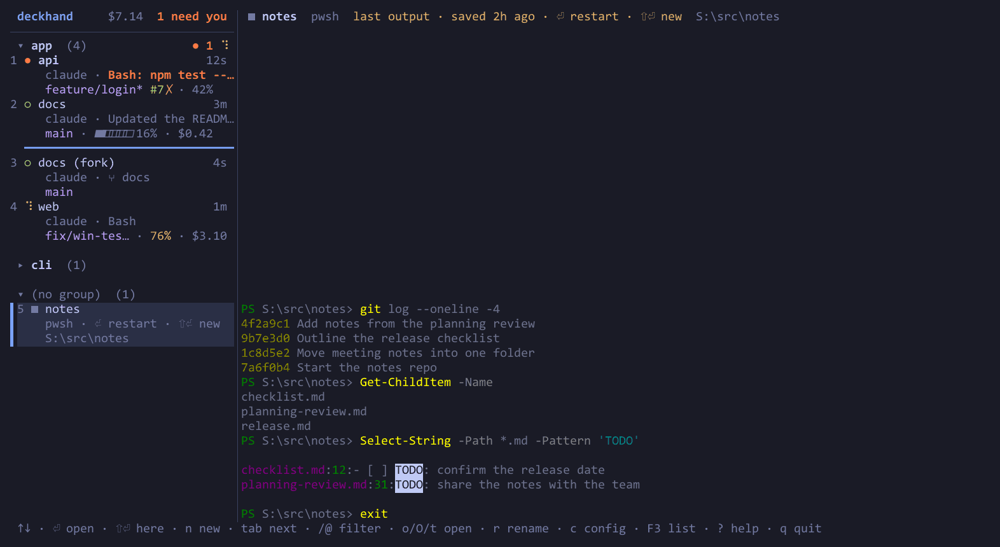

```
 ▾ app  (3)             ● 1 ⠹ ✓ 1
 1 ● api                      12s
     claude · Bash: npm test
     feature/login* · opus 5.5 · 84k
 ...

 ▸ cli  (1)                    ✓ 1

 ▾ (no group)  (1)
 4 ■ notes
```

- **Making a group:** press `a` on a session, type a name and press enter (`+ new group "name"`). `a` also moves a session to another group, or to `(no group)`.
- **Headers:** `▾` is open and `▸` folded; the count is how many sessions the group has. Every header also sums up its sessions on the right: `● N` need you (blinking, like a session), a spinner if any is working, and `✓ N` finished and unread. So a folded group still shows when something in it needs you, and `tab` opens a folded group when the next session that needs you is in it.
- **On a header:** `space` or `enter` folds or unfolds the group (`←` folds, `→` unfolds), `r` renames it and `x` deletes it after asking. Deleting a group moves its sessions to `(no group)`; it never removes a session. `shift+↑/↓` moves the whole group, and `shift+home/end` moves it to the top or the bottom.
- **On a session:** `shift+↑/↓` moves it within its group, and past the group's edge into the group above (at its end) or below (at its top), opening that group if it's folded. `shift+home/end` moves it to the top or the bottom of its group.
- **Numbers:** `1`–`9` count only the sessions you can see, so headers and folded sessions are skipped.
- **"(no group)"** holds the sessions that aren't in a group. It's always last, and only shows when it has sessions and at least one group exists.
- **Empty groups** stay, showing `(0)`, so you can move sessions back in. `x` on the header deletes one.
- **New sessions:** `shift+enter` and `W` put the new session in the same group as the one it came from. `n` picks the selected session's group (or the selected header's); the dialog has a Group row to change it (`←/→`).
- **Filters:** `/` and `@` search every group. Matching sessions in folded groups show while the filter is on, and headers with no matches hide.
- **Dragging with the mouse:**
  - Drop a session between two sessions of a group, or on the top line of its first session, to put it there. The drop line is indented under the group it lands in.
  - Drop it on a group's header to add it at the end of that group. That works for a folded group too: the header lights up while you're over it, and the group stays folded (its count goes up). Hold it over a folded header for about a second to open the group and drop at an exact place; it folds again if you move on without dropping.
  - Drop it in `(no group)`, or on its header, to take it out of its group. When every session is in a group, a `(no group)` target shows at the bottom of the list while you drag.
  - Drag a group's header to move the group, with its sessions, between the others: on a header it goes above that group, on a group's sessions below it. Groups can't go inside other groups.
- **Where it's saved:** each session's group is in `sessions.json` (`"group"`), and the groups' order and which are folded in `groups.json` beside it, so a deckhand from before groups still reads `sessions.json`.

Automatic grouping by repo or folder (`[list] group_by`) isn't there yet.

## Hiding the session list

Press `F3` to hide the session list and give the selected session the full window width. Press it again to show the list. It works the same in the list and inside a session, where `F3` no longer reaches the agent. Claude Code binds no function keys by default, Codex uses `F2` and Gemini CLI uses `F4`, `F6`–`F9` and `F12`, so `F3` is free in all three, and neither Windows Terminal nor WezTerm binds it. The first default, `ctrl+\`, is 1Password's global shortcut on Windows, so it never reached deckhand on machines running 1Password. You can choose another key in the config (below).

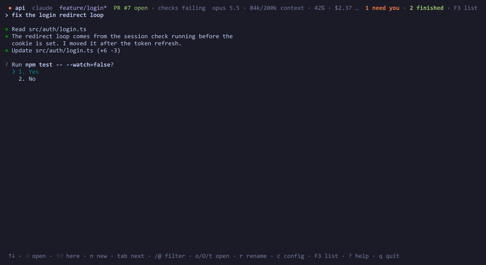

- Every session is resized to the new width, as when the window is resized.
- `F5` still goes back to the list, and shows it again if it's hidden. `/` shows it too, since the filter is typed at the top of the list.
- The wheel and clicks all go to the terminal while the list is hidden.
- The end of the session header shows which sessions need you, by the same rules as the list's badge and `@`: `1 need you · 1 finished · F3 list`. The window title still says "(n need you)".
- deckhand remembers whether the list is hidden (in `%LOCALAPPDATA%\deckhand\prefs.json`) and starts the same way next time.

### Going back to the list

Inside a session, `F5` goes back to the session list, and shows it again if it's hidden. In the list, it shows a hidden list. It's free in the same agents and terminals as `F3`: Claude Code binds no function keys, Codex uses `F2`, Gemini CLI uses `F4`, `F6`–`F9` and `F12`, Windows Terminal binds `F11` (fullscreen) and WezTerm binds none. That left `F5` and `F10`, and `F10` means "menu" in other apps.

`ctrl+q` and `ctrl+]` do the same as `F5`, for keyboards where the F keys need `Fn`, terminals that take them, and muscle memory. They can't be changed, and only the help (`F1`) shows them.

Change the keys, or turn off the status line, on the [config screen](#the-config-screen) or in the config file:

```toml
[list]
toggle_key  = "f3"     # the default; or "f2", 'ctrl+\' (single quotes keep the \), ...
back_key    = "f5"     # the default; or "f10", ...
status_line = true     # false: no "n need you" in the header while the list is hidden
follow_claude_title = true  # false: Claude's title doesn't rename sessions (see Session names)
```

Neither key can be a plain character, or a key deckhand or the agents need (`enter`, `esc`, `tab`, the arrows, `ctrl+q`, `ctrl+]`, `ctrl+c`, `F1`), and the two can't be the same key.

## Opening a session's folder

To look at what an agent changed, press `o` to open the selected session's folder in your editor, `O` to open it in Explorer, or `t` to open a new tab in the current Windows Terminal window, starting in that folder. This works whether the session is running or not.

| Key | Default |
|---|---|
| `o` | `code "{dir}"` if VS Code is on PATH, otherwise Explorer. The first time it falls back to Explorer, the footer says how to set an editor. |
| `O` | `explorer.exe "{dir}"` |
| `t` | `wt.exe -w 0 nt -d "{dir}"` |

Set your own editor or terminal command in the config file:

```toml
[open]
editor   = 'rider64.exe "{dir}"'        # or 'code "{dir}"', 'idea64.exe "{dir}"', ...
terminal = 'wt.exe -w 0 nt -d "{dir}"'
```

- `{dir}` is the session's folder. Each command must contain it.
- deckhand splits the command into a program and its arguments first (double or single quotes group words with spaces), then fills in `{dir}`. A folder name with spaces or other characters stays one argument and can't add arguments of its own. No shell is used. To run a PowerShell command, write `pwsh -c ...` yourself.
- The program runs in the background without a console window, and deckhand doesn't wait for it. If it can't start, the footer shows "Couldn't open: ...".
- A `.cmd` or `.bat` file (such as VS Code's `code.cmd`) runs through `cmd.exe` with every argument quoted. A folder with `%` in its name can't be passed to one safely, so deckhand refuses and shows an error.

## Path aliases

deckhand shows the home folder as `~` everywhere it shows a path: the session list, the session header, the new-session dialog and its suggestions, the config screen, the diff preview, worktree, PR and merge messages, help and notifications. For demos and screen sharing, aliases can hide other folders behind a short name too:

```toml
[[paths.alias]]
prefix = 'C:\src\notes'     # ~ works here too: '~\src\notes'
name   = "notes"
```

With it, `C:\src\notes\features\x` shows as `notes\features\x`.

- Matching ignores case and works only at folder boundaries, so `C:\src\notes2` isn't matched. The longest matching prefix wins, and aliases come before `~`. There are none by default.
- It's display only: `sessions.json`, the commands deckhand runs and what the agents see keep the real paths. Paths an agent prints in its own terminal aren't changed.
- The new-session dialog takes real paths, and also `~\…` and an alias followed by `\` (`notes\features`), so the folders it fills in show the same way.
- The config screen lists the aliases' names (not their prefixes). They're edited in `config.toml`.

## Resuming

The session list is saved in `%LOCALAPPDATA%\deckhand\sessions.json`. Each Claude session is started with its own `--session-id`, so after you quit and restart deckhand, pressing enter on a Claude session runs `claude --resume <id>`.

## More than one window

You can run more than one deckhand at a time, like Notepad's windows:

- The first one started is the **main** window. It shows the saved sessions and saves changes to them, as described above.
- Any deckhand started while the main one is running is a **temporary** window. It says `temporary` next to "deckhand" in the list header, and its title is `deckhand (temporary)`. It starts with an empty list, and its sessions aren't saved: when it closes, they're gone from deckhand. Their Claude conversations still exist, and `claude --resume <id>` resumes one. Quitting asks first only when sessions are running, as in the main window.
- `deckhand --temp` starts a temporary window even when no main one is running (for a demo, say).
- In a temporary window the config screen (`c`) shows the config but can't save it, and groups are off (`a` says they're saved only in the main window). Recent folders and the other preferences in `prefs.json` are shared: each change is merged into the file, so neither window undoes the other's.
- When the main window closes, temporary ones stay temporary. The next deckhand started becomes the main one and shows the saved sessions. A main window that crashed doesn't get in the way: Windows releases its lock (a named mutex per data folder; `deckhand.lock` on other systems) when the process ends.
- Each data folder (`DECKHAND_HOME`) has its own main window.

`sessions.json` and `groups.json` keep fields this deckhand doesn't know, so an older build doesn't drop a newer one's data. `state.json` records the format of the saved files; a deckhand that finds a newer format than it knows runs as a temporary window ("sessions were saved by a newer deckhand") instead of overwriting them.

> [!WARNING]
> A deckhand from before temporary windows doesn't know about the main window. If you keep an older build (such as a `deckhand.old.exe`), don't run it at the same time as a newer one: it acts as a main window too, and the last one to save overwrites the other's sessions.

## Forking

`f` in the list forks the selected Claude session: a new session, right below it, that starts with a copy of its conversation. Then you can try another approach without losing the original. shift+enter is different: it starts a fresh conversation with the same agent and folder.

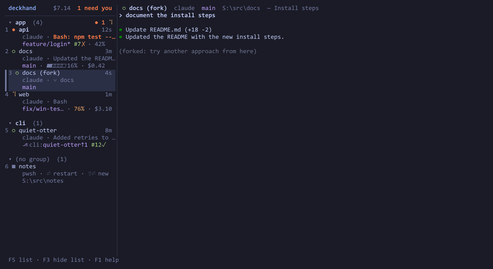

- The fork is selected and starts at once. It's named `<name> (fork)`, or `(fork 2)` and so on if that name is taken; `r` or `/rename` in the fork renames it (Claude's automatic title doesn't). Until you send it a prompt, its second line in the list shows `⑂ <original name>`.
- Claude makes the copy: deckhand runs `claude --resume <original's id> --fork-session --session-id <new id>`, so the fork has its own Claude session ID and transcript, and the original's conversation isn't changed. `sessions.json` records which session it was forked from (`forked_from`). After a restart, enter resumes the fork's own conversation.
- A custom `pwsh` agent with `type = "claude"` (such as `smc`) runs its `resume` command with the original's ID, and the [claude shim](#custom-agents-your-own-scripts-and-profile-functions) adds `--fork-session` and the new `--session-id`. Without a `resume` command it can't fork.
- The original has to have started at least once, and it can be running or exited. While it's in the middle of a turn (working, or waiting for a permission answer), `f` says to wait for it to finish its turn.
- Agents that aren't Claude can't fork; `f` says so.
- A fork of a worktree session works in the same worktree, and shows its branch, but doesn't own it: `x` on the fork only removes the fork from the list, and the worktree stays with the original.

## Output after a restart

Each session's output (its scrollback and screen, with colours, at most 5000 lines) is saved to `%LOCALAPPDATA%\deckhand\sessions\<id>\screen.ans`: when deckhand quits (before it ends the running sessions), when a session's process exits, and every 30 s while a session prints something. Writes go to a temporary file that is then renamed, so a crash leaves the previous save. On the alternate screen (a fullscreen app such as Claude's fullscreen renderer) only the visible screen is saved.

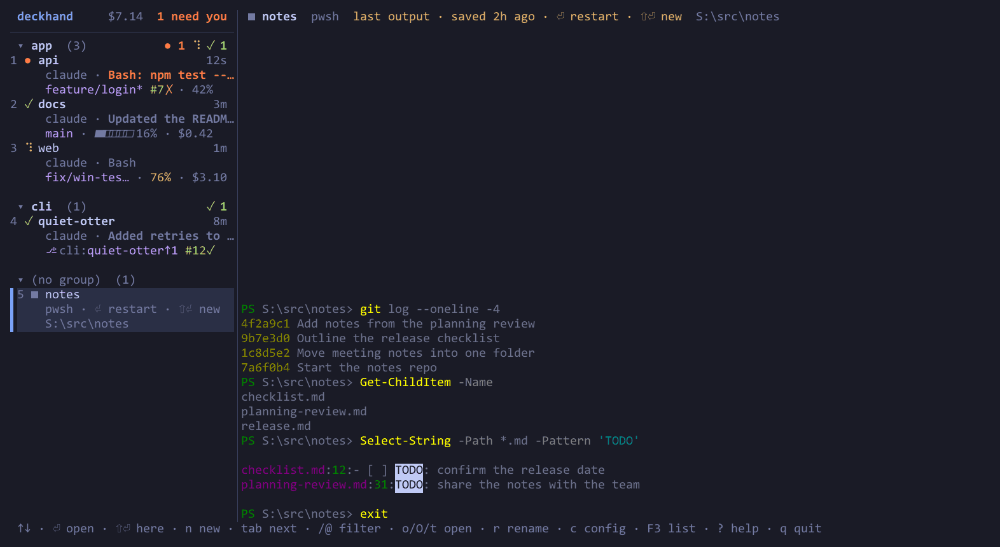

After deckhand restarts, an exited session shows that output instead of "Not running", dimmed so it's clear it isn't live. The header says `last output · saved 2h ago · ⏎ resume · ⇧⏎ new`. The wheel and shift+PgUp/PgDn scroll it like a live session's scrollback. Lines saved at another width are cut or padded, not re-wrapped. Pressing enter resumes or restarts the session as before, and the live terminal replaces the saved output.

For a Claude session, deckhand can also show the conversation from Claude's transcript: the last prompts (`> ...`) and replies, without tool calls, sub-agents or Markdown. It shows by itself when there's no saved output (sessions from before this feature, for example), and `v` in the list switches between the two (`last output · v conversation`). The choice isn't saved; each restart starts on the last output.

```toml
[history]
save  = true     # false: don't save session output to disk
lines = 5000     # lines kept per session, 1 to 5000
```

> [!NOTE]
> The saved output is whatever was on screen, so it can include secrets a command printed. It stays in your own `%LOCALAPPDATA%\deckhand` folder, next to the hook events deckhand already keeps there. Removing a session (`x`) deletes its folder and the file. `save = false` stops saving; files saved earlier stay (and are still shown) until you remove the session or delete its `screen.ans`.

## Build

```powershell
go install github.com/sayedihashimi/deckhand@latest          # or, from a clone:
go build -ldflags "-X main.version=0.1.0" -o $HOME\.local\bin\deckhand.exe .
go test ./...                                              # unit tests
go test -tags e2e -run TestE2EShell -v                     # drives deckhand in a real ConPTY
$env:DECKHAND_E2E_CLAUDE=1; go test -tags e2e -run TestE2EClaude -v   # sends one tiny prompt
```

The screenshots in this README are generated: `TestE2EReadmeShots` plays a scripted scene with fake Claude sessions and writes one PNG per shot to `docs/img`. To regenerate them all:

```powershell
$env:DECKHAND_SCREENSHOTS="docs/img"; go test -tags e2e -run TestE2EReadmeShots -v -timeout 20m
```

Install the binary in a folder without spaces in its path. Hook commands then don't need quoting, so they work whichever shell Claude runs them in.

## Debugging

Set `DECKHAND_DEBUG=C:\path\to\log.txt` to log key presses and releases (as deckhand received them), whether win32-input-mode was turned on and why, the bytes forwarded to each agent, and notification errors. If a key does nothing, this log shows what the terminal actually sent. `DECKHAND_NOTIFY_LOG=C:\path\to\file` writes notifications to that file instead of showing them (the tests use this). Each session's hook events are in `%LOCALAPPDATA%\deckhand\sessions\<id>\events.jsonl`.
